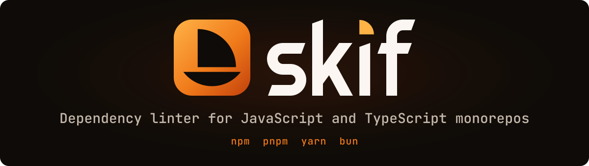

<!-- markdownlint-disable MD033 MD041 -->
<div align="center">

<h1 align="center"></h1>

npm · pnpm · yarn · bun · **54 rules** · **213 plugins** · format-preserving fixes

[](https://crates.io/crates/skif)
[](https://www.npmjs.com/package/@polylint/skif)
[](https://github.com/polylint/skif/actions/workflows/ci.yml)
[](https://polylint.github.io/skif/)
[](LICENSE)

[Docs](https://polylint.github.io/skif/) · [Benchmarks](https://polylint.github.io/skif/guides/benchmarks/) · [Comparison](https://polylint.github.io/skif/guides/comparison/) · [Install](#installation) · [Quick start](#quick-start) · [Rules](docs/rules.md)

</div>

---

skif is a dependency linter for JavaScript and TypeScript repositories, written in Rust. One binary and one
`skif.toml` cover what sherif (monorepo and manifest rules), syncpack (version and catalog policies) and knip (unused
files, exports and dependencies) check. The dead-code analysis parses with [oxc](https://oxc.rs). skif reads tool
configurations statically and runs no project code while linting, its fixes keep key order, indentation and comments,
and `skif migrate` translates an existing sherif, syncpack and knip setup in one step.

## Performance

<!-- bench:claims:start -->
- [**4.0–8.0x faster than knip**](https://polylint.github.io/skif/guides/benchmarks/#speed) (median 5.5x) for dead-code analysis, on 7 pinned public repositories where knip completes (knip fails on create-t3-turbo and vue-core and on n8n and next-js it exits with an error after its report).
- [**up to 7.9x faster than sherif**](https://polylint.github.io/skif/guides/benchmarks/#speed) (median 3.2x), and slower on 3 of 12 targets for manifest and workspace checks (`skif --no-js`), on 9 pinned public repositories and 3 generated workspaces of 50, 500 and 2000 packages.
- [**1.6–22.3x faster than syncpack**](https://polylint.github.io/skif/guides/benchmarks/#speed) (median 8.6x) for version-policy checks (`skif --no-js`), on 9 pinned public repositories and 3 generated workspaces of 50, 500 and 2000 packages.

skif 0.9.0 against knip 6.45.1, sherif 1.13.0, syncpack 15.3.3: medians of 15 runs (5 on angular, vscode, n8n and next-js) on a GitHub-hosted runner, measured on 2026-11-17.
<!-- bench:claims:end -->

The knip numbers time a whole skif run as it runs by default; the sherif and syncpack numbers time `skif --no-js`,
which runs the manifest and policy rules those tools cover. Each claim links to the
[benchmarks page](https://polylint.github.io/skif/guides/benchmarks/), which gives the tables per repository and
workspace, the workflow run the numbers come from, the methodology, the accuracy on seeded defects and the agreement
with knip on real repositories.

## Installation

```bash
pnpm add -D @polylint/skif            # or npm install -D, yarn add -D, bun add -D; the command is `skif`
cargo binstall skif-cli               # prebuilt binary; or cargo install skif-cli
brew install polylint/tap/skif       # Homebrew
```

```powershell
scoop bucket add polylint https://github.com/polylint/scoop-bucket
scoop install skif
```

The npm package needs Node.js 22, 24 or 26, or Bun 1.x, on macOS, Linux or Windows.

GitHub Action:

```yaml
- uses: actions/checkout@v7
- uses: polylint/skif@v0.9
  with:
    fail-on-warnings: true
```

pre-commit or prek (needs neither Rust nor Node):

```yaml
repos:
  - repo: https://github.com/polylint/skif
    rev: v0.9.2 # use the latest release tag
    hooks:
      - id: skif       # lints manifests, skipping JS analysis
      - id: skif-fix   # optional: also applies safe fixes
```

The [installation guide](https://polylint.github.io/skif/start/installation/) lists every channel, the prebuilt
archives and the supported versions; the [integrations guide](https://polylint.github.io/skif/guides/integrations/)
covers the Action inputs, Poly, Lefthook, GitLab CI and the npm API.

## Quick start

```bash
npx @polylint/skif                  # lint the workspace or package you are in
npx @polylint/skif --fix --dry-run  # show the safe fixes as a diff
npx @polylint/skif --fix            # apply them, then run the package manager's install
npx @polylint/skif migrate          # translate sherif, syncpack and knip config into a skif.toml
npx @polylint/skif baseline write   # record the findings you cannot fix yet; CI then accepts only fewer
```

skif works without configuration. `skif init` writes a starter `skif.toml`, and files layer from a project up to the
git root, so one organisation file applies to every project below it. See the
[quickstart](https://polylint.github.io/skif/start/quickstart/) and the
[configuration reference](https://polylint.github.io/skif/reference/configuration/).

## Features

- **Manifest and workspace rules**: root `private` and `packageManager`, sorted and empty dependency maps, `@types`
  in `dependencies`, unmatched workspace patterns, stray lockfiles, nested workspace roots, Lerna configuration.
- **Version policy**: version and semver-range groups, banned dependencies, dependency families, the `workspace:`
  protocol, catalogs (pnpm, Bun, Yarn 4.10+) and toolchain pins (`packageManager`, `engines`, `.nvmrc`, Dockerfiles,
  workflows, `MODULE.bazel`). `skif update` finds newer published versions; it is the only command that uses the
  network.
- **Dead-code analysis on [oxc](https://oxc.rs)**: unused files, exports, types, enum, namespace and class members
  and `package.json` subpaths; unused and unlisted dependencies, unlisted binaries and unresolved imports; duplicate
  exports; circular imports. Vue, Svelte, Astro, MDX and Marko files are read, and 213 plugins read the configuration
  of common tools.
  `skif explain-usage` says why a file, export, member or dependency counts as used.
- **Monorepo layouts**: npm, pnpm, Yarn 2+, Yarn Classic and Bun workspaces, single packages, `skif -r` over many
  roots, Rush, [Turborepo, Nx and Lerna](https://polylint.github.io/skif/guides/turborepo-nx-lerna/), and
  [Bazel with rules_js](https://polylint.github.io/skif/guides/bazel/).
- **Fixes**: safe and unsafe levels, `--fix-type` to fix some rules only, `--dry-run` diffs, and `skif format` for
  `package.json` layout.
- **CI output**: human, JSON, TOON, SARIF, GitHub annotations, GitLab Code Quality, compact, Markdown and
  CODEOWNERS reports, several in one run, with stable rule ids and documented exit codes.
- **Cache**: parse results are kept between runs by default, below `node_modules/.cache/skif` or the per-user cache
  directory, and never change a report. `--no-cache`, `SKIF_CACHE=0` or `[cache] enabled = false` turns it off, and
  `skif cache stats` and `skif cache clean` inspect and remove it.
- **Editors and agents**: watch mode, a language server, an MCP server and an
  [agent skill](https://polylint.github.io/skif/guides/editors-and-agents/#agent-skill).
- **Library**: the [`skif`](crates/skif/README.md) crate does no I/O of its own and puts the JS analysis behind its
  `js-analysis` feature and its disk cache store behind `cache-disk`, and the npm package exports `lint`, `lintAsync`
  and `run`. See the [library guide](https://polylint.github.io/skif/guides/library/).

## Support

| | skif |
| --- | --- |
| Package managers | npm, pnpm, Yarn 2+, Yarn Classic, Bun |
| Linkers tested end to end in CI | npm (hoisted); pnpm (isolated, `nodeLinker: hoisted`); Yarn 2+ (Plug'n'Play, `nodeLinker: node-modules`, `nodeLinker: pnpm`); Yarn Classic (hoisted); Bun (default, `linker = "hoisted"`, `linker = "isolated"`) |
| Runtime | Native binary, or through npm on Node.js 22, 24, 26 and Bun 1.x |
| Platforms | macOS, Linux (glibc, musl), Windows; x64, arm64 |

Versions per package manager and operating system are under
[supported versions](https://polylint.github.io/skif/start/installation/#supported-versions). The
[comparison guide](https://polylint.github.io/skif/guides/comparison/) compares skif with sherif, syncpack and knip
capability by capability, with sources.

## Documentation

- [Introduction](https://polylint.github.io/skif/start/introduction/) and
  [quickstart](https://polylint.github.io/skif/start/quickstart/)
- [Rules](https://polylint.github.io/skif/rules/) ([`docs/rules.md`](docs/rules.md))
- [CLI reference](https://polylint.github.io/skif/reference/cli/) and
  [configuration reference](https://polylint.github.io/skif/reference/configuration/)
- [Migrating from sherif, syncpack and knip](https://polylint.github.io/skif/guides/migrating/)
- [Benchmarks](https://polylint.github.io/skif/guides/benchmarks/) and
  [comparison](https://polylint.github.io/skif/guides/comparison/)

## polylint organization

skif is part of [polylint](https://github.com/polylint), a set of Rust linters and formatters. Sibling tools:
[polylint](https://github.com/polylint/polylint) (one linter and formatter for every language; it can run skif as an
engine), [adrlint](https://github.com/polylint/adrlint) (MADR decision records),
[uncomment](https://github.com/polylint/uncomment) (comment removal and linting). Install any of them from the Homebrew
tap (`brew tap polylint/tap`) or the Scoop bucket.

## Contributing

See [CONTRIBUTING.md](CONTRIBUTING.md) and [SECURITY.md](SECURITY.md). Design decisions are recorded as
[architecture decision records](adrs/index.md).

## License

MIT, see [LICENSE](LICENSE). skif started as a fork of sherif, vendors parts of syncpack and follows knip's issue types
and plugin knowledge; derived code is credited in [ATTRIBUTIONS.md](ATTRIBUTIONS.md).
