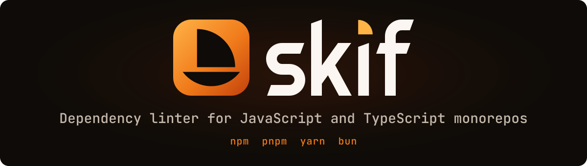

<!-- markdownlint-disable MD033 MD041 -->
<div align="center">

<h1 align="center"></h1>

**One fast binary for the dependency checks your monorepo spreads across three tools.**

skif lints manifests, enforces version and catalog policies, and finds unused dependencies and dead code,
with one config file and one report. It never runs your project's code.

npm · pnpm · yarn · bun · **41 rules** · **106 plugins** · format-preserving fixes

[](https://crates.io/crates/skif)
[](https://www.npmjs.com/package/skif-cli)
[](https://github.com/Goldziher/skif/actions/workflows/ci.yml)
[](https://goldziher.github.io/skif/)
[](LICENSE)

[Docs](https://goldziher.github.io/skif/) · [Quick start](#quick-start) · [Compare](#how-it-compares) · [Benchmarks](#benchmarks) · [Install](#installation) · [Rules](docs/rules.md)

</div>

---

## What you get

| | |
| --- | --- |
| **One tool** | Manifest hygiene, version policy and dead-code analysis in one run, one `skif.toml` and one report. |
| **Fast** | 4 to 37 times faster than knip on real repositories. Manifest checks beat sherif on every real repository and syncpack on every target; sherif wins at 2,000 generated packages. [See the numbers.](#benchmarks) |
| **Safe** | Analysis is static: skif reads your code and configs without running them. Fixes keep key order, indentation and comments. |
| **Easy to adopt** | `skif migrate` translates your sherif, syncpack and knip configuration in one step. |
| **Built for CI** | Human, JSON, SARIF and GitHub annotation output, stable rule ids and a GitHub Action. |
| **Embeddable** | The [`skif`](crates/skif/README.md) crate is a library that does no I/O of its own. |

## Quick start

```bash
npx skif-cli              # lint the workspace or package you are in
npx skif-cli --fix        # apply safe fixes
npx skif-cli migrate      # turn sherif, syncpack and knip config into a skif.toml
```

With skif installed, the command is `skif`. See the [CLI reference](https://goldziher.github.io/skif/reference/cli/).

## How it compares

skif builds on [sherif](https://github.com/QuiiBz/sherif), [syncpack](https://github.com/JamieMason/syncpack) and
[knip](https://github.com/webpro-nl/knip), which remain excellent, focused tools. It started as a fork of sherif and
follows knip's issue types. The difference is that one tool covers all three jobs.

| | skif | sherif | syncpack | knip |
| --- | --- | --- | --- | --- |
| Manifest and workspace rules | Yes | Yes | No | No |
| Version and semver-range policy | Yes | Version mismatches | Yes | No |
| Catalog policy | Yes | No | Yes | Catalog entries |
| Unused dependencies, files and exports | Yes | No | No | Yes |
| Runs project code to read configs | No | No | No | Yes |

skif is younger than all three. The JS analysis is close to knip but not identical, and
[the differences are published](#agreement-with-knip).

## Benchmarks

Medians of 10 runs on an Apple M4 Pro, on [pinned public repositories](tools/bench/corpus.toml) with dependencies
installed. The machine was still busy during this run (load average around 17), so treat the ratios as the result.
Reproduce with `mise run bench:publish`.

**Dead-code analysis against knip** (full skif run)

| Repository | skif | knip | Faster by |
| --- | ---: | ---: | ---: |
| create-t3-turbo | 22 ms | 824 ms | 37x |
| vue-core | 37 ms | 1.3 s | 35x |
| tanstack-query | 175 ms | 1.8 s | 10x |
| babel | 420 ms | 3.9 s | 9x |
| npm-cli | 82 ms | 315 ms | 4x |

knip stops early on two of these, so its time is not a full analysis: it exits with an error on create-t3-turbo, and
npm's `.gitignore` hides every workspace of npm-cli from it.

**Manifest and policy checks** (`skif --no-js`)

| Target | skif | sherif | syncpack |
| --- | ---: | ---: | ---: |
| create-t3-turbo | 4.6 ms | 32 ms | 46 ms |
| vue-core | 5.0 ms | 33 ms | 38 ms |
| tanstack-query | 17 ms | 41 ms | 109 ms |
| babel | 13 ms | 40 ms | 495 ms |
| npm-cli | 6.5 ms | 35 ms | 89 ms |
| Generated, 500 packages | 54 ms | 61 ms | 176 ms |
| Generated, 2000 packages | 268 ms | 194 ms | 869 ms |

### Accuracy on seeded defects

A generated 500-package workspace with defects injected on purpose. `Actual` is counted from the files, so the right
answer is known:

| Defect | Actual | skif | sherif | syncpack |
| --- | ---: | ---: | ---: | ---: |
| Dependencies with mismatched versions | 200 | 200 | 200 | 200 |
| Unsorted dependency maps | 25 | 25 | 25 | n/a |
| Type packages in `dependencies` | 24 | 24 | 24 | n/a |
| Empty dependency objects | 31 | 31 | 31 | n/a |

skif and sherif name the same 200 dependencies. skif and syncpack report the same 4,568 mismatched instances, with
nothing unique to either. `n/a` means the tool does not check for that defect.

### Agreement with knip

Dead code has no answer key, so this measures agreement, not correctness: findings skif and knip share on 14 pinned
repositories. A low score means the tools differ, and either one could be right. Reading the disagreements found
false findings on both sides, and skif's are fixed in the current source
([ADR 0049](adrs/0049-js-corrections-from-adjudicating-knip-disagreements.md)).

| Finding | Shared | Of skif's findings | Of knip's findings |
| --- | ---: | ---: | ---: |
| Unused files | 27,193 | 92% | 73% |
| Unused exports | 9,997 | 96% | 86% |
| Unused types | 5,011 | 90% | 87% |
| Unlisted dependencies | 959 | 91% | 34% |
| Unused dev dependencies | 917 | 86% | 76% |
| Unused dependencies | 467 | 84% | 66% |
| Unresolved imports | 69 | 34% | 56% |
| Unlisted binaries | 32 | 89% | 21% |

Method, caveats and every run: [`tools/bench`](tools/bench/README.md).

## Installation

<details open>
<summary><strong>npm, pnpm, yarn or bun</strong></summary>

The package is `skif-cli`; the command it installs is `skif`.

```bash
pnpm add -D skif-cli     # or npm install -D, yarn add -D, bun add -D
pnpm dlx skif-cli        # or npx skif-cli, yarn dlx skif-cli, bunx -p skif-cli skif
```

Needs Node.js 22, 24 or 26, or Bun 1.x, on macOS or Linux. There are no npm packages for Windows; use Scoop or Cargo.

</details>

<details>
<summary><strong>Homebrew</strong></summary>

```bash
brew install goldziher/tap/skif
```

</details>

<details>
<summary><strong>Scoop</strong></summary>

```powershell
scoop bucket add goldziher https://github.com/Goldziher/scoop-bucket
scoop install skif
```

</details>

<details>
<summary><strong>Cargo</strong></summary>

```bash
cargo install skif-cli    # or cargo binstall skif-cli
```

The `skif` crate is the library; `skif-cli` is the command-line tool.

</details>

<details>
<summary><strong>GitHub Action</strong></summary>

```yaml
- uses: actions/checkout@v7
- uses: Goldziher/skif@v0.1
  with:
    fail-on-warnings: true
```

See the [Action guide](https://goldziher.github.io/skif/guides/integrations/) for inputs and version pinning.

</details>

<details>
<summary><strong>pre-commit or prek</strong></summary>

```yaml
repos:
  - repo: https://github.com/Goldziher/skif
    rev: v0.1.0 # use the latest release tag
    hooks:
      - id: skif       # lints manifests, skipping JS analysis
      - id: skif-fix   # optional: also applies safe fixes
```

Needs neither Rust nor Node. See the [hooks guide](https://goldziher.github.io/skif/guides/integrations/) for Poly and
Lefthook.

</details>

Prebuilt archives and supported versions are listed in the
[installation guide](https://goldziher.github.io/skif/start/installation/).

## Configuration

skif works with no configuration. To adjust it, add a `skif.toml`:

```toml
[rules]
unsorted-dependencies = "warn"

[[ignore]]
rules = ["version-mismatch"]
dependencies = ["wrangler"]
reason = "workers still on the v2 runtime"
```

`skif init` writes a starter file. Files layer from your project up to the git root, so an organisation file applies to
every project below it. See the [configuration reference](https://goldziher.github.io/skif/reference/configuration/).

## Library

```bash
cargo add skif
```

The `skif` crate never prints, exits or writes files, so a host can embed the rules. Poly is the first host. See the
[library guide](https://goldziher.github.io/skif/guides/library/).

## Contributing

See [CONTRIBUTING.md](CONTRIBUTING.md) and [SECURITY.md](SECURITY.md). Design decisions are recorded as
[architecture decision records](adrs/index.md).

## License

MIT, see [LICENSE](LICENSE). skif started as a fork of sherif, vendors parts of syncpack and follows knip's issue types
and plugin knowledge; derived code is credited in [ATTRIBUTIONS.md](ATTRIBUTIONS.md).
